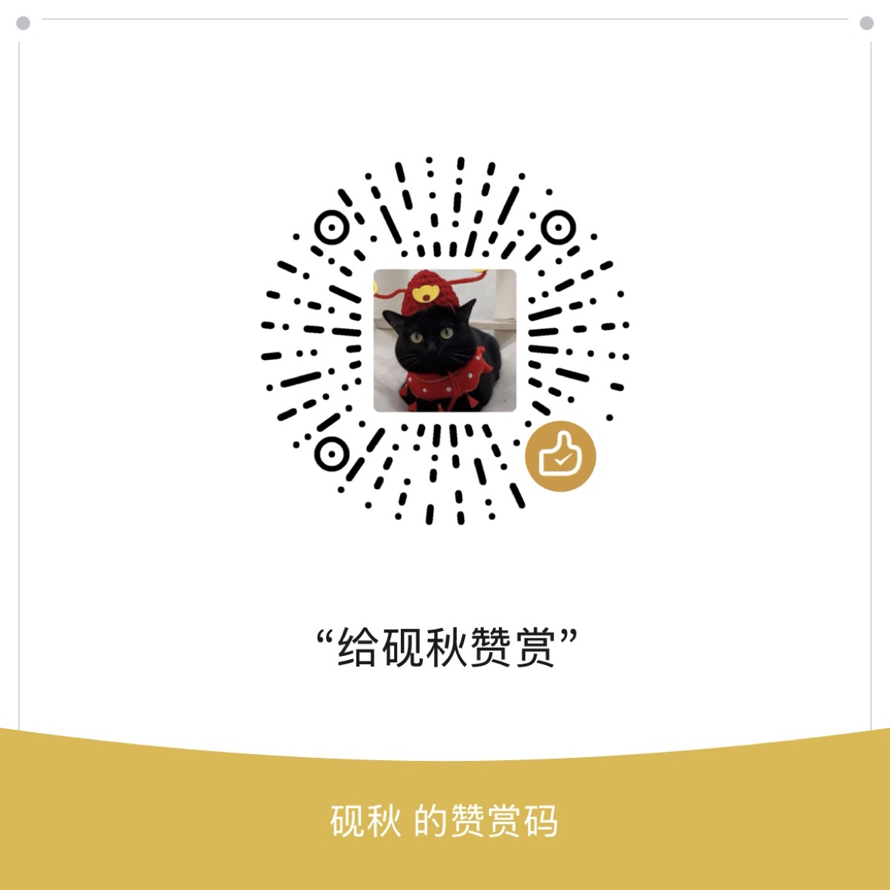

# Aetrix Emby Portal
English: [README.en.md](README.en.md)

[](LICENSE)
[](https://github.com/xzb177/Aetrix-Emby-Portal/actions/workflows/ci.yml)
[](docs/deploy-docker.md)

自建影视媒体服务器，实现 Emby 客户端常用的协议面（`/emby/*`），第三方 Emby 客户端直连，无需部署官方 Emby Server。播放只走直链与中继直出，不做服务端转码。

Python 3.12 + FastAPI · Vue 3 + TypeScript · PostgreSQL · Redis 7 · ffmpeg

---

## 这是什么

Aetrix Portal 是一套自托管的影视媒体服务器。后端实现了 Emby 客户端常用的协议端点（认证、浏览、`PlaybackInfo`、取流、字幕、进度上报），Infuse、SenPlayer、Forward、Emby 官方 App 等客户端可以把它当作一台 Emby Server 直接连接——但服务端完全由本项目提供，不依赖官方 Emby Server。服务端不转码（`SupportsTranscoding` 恒为 false），需要转码才能播的格式要靠客户端自己解码。

系统按职责拆成两个进程：**EM**（面板，用户门户 / 管理后台 / 媒体库扫描 / 会员计费）和 **EA**（Emby 协议网关，认证 / 浏览 / 出流 / 字幕）。两者共用同一个 PostgreSQL 和同一个 `SECRET_KEY`，默认单机部署（自建版是 api / ea / worker 三个容器，授权版合并为一个容器），也可以拆到不同机器上分离部署。

面向自己搭服务器、自己管媒体库和用户的技术用户。

---

## 架构

| 组件 | 职责 |
| --- | --- |
| **EM** | 面板：用户门户、管理后台、媒体库扫描、会员计费 |
| **EA** | Emby 协议网关：认证、浏览、出流（直链 / 中继直出）、字幕 |
| **PostgreSQL** | 元数据、用户、计费数据（默认） |
| **Redis 7** | 缓存、会话、任务队列 |
| **ffmpeg** | 辅助用途：内封文本字幕抽取、缩略图抽帧等（不做视频转码） |

```
Emby 客户端 ──HTTP──▶ EA（出流）
浏览器 ──▶ EM（面板）──┴──▶ PostgreSQL ──▶ 你的硬盘
                        └──▶ Redis
```

EM 与 EA 必须配置相同的 `SECRET_KEY`；默认部署形态为单机部署，可通过环境变量指向远端 PostgreSQL / Redis 实现分离部署，参见 [docs/deploy-ea.md](docs/deploy-ea.md)。

---

## 快速部署

需要 Docker 与 Docker Compose v2。

```bash
git clone https://github.com/xzb177/Aetrix-Emby-Portal.git
cd Aetrix-Emby-Portal
cp env.example .env
```

编辑 `.env`，至少填两项：

```bash
# 生成一个足够强的值，EM 与 EA 必须一致
python3 -c "import secrets; print(secrets.token_urlsafe(48))"

SECRET_KEY=<上面生成的值>
POSTGRES_PASSWORD=<自定义数据库密码>
```

启动后端：

```bash
./scripts/deploy.sh
```

`scripts/deploy.sh` 用于首次部署，会拉起以下服务：

| 服务 | 说明 |
| --- | --- |
| `aetrix-api` | EM 面板 API（只提供接口，不提供网页） |
| `aetrix-ea` | EA Emby 协议网关 |
| `aetrix-worker` | 维护、刮削补全、到期提醒、定时扫描、追新、Redis 扫描队列 |
| `postgres` | 数据库 |
| `redis` | 缓存与队列 |

网页前端（用户端 + 管理后台）不在上面的脚本里，它是另一个容器 `aetrix-web`
（nginx，宿主机端口 8081）。想要网页，把两份编排文件一起起：

```bash
docker compose -f docker-compose.yml -f docker-compose.frontend.yml up -d
```

注意：脚本路线与组合命令路线二选一、不要混用（脚本的 `--remove-orphans`
会摘掉不在默认编排文件里的 `aetrix-web`）。完整教程见 [docs/deploy-docker.md](docs/deploy-docker.md)。

后续更新：`scripts/update.sh` 会 `git pull` 后重新构建并重启后端服务；
它只尝试备份 SQLite，默认的 PostgreSQL 部署更新前请先运行 `scripts/backup_db.sh` 备份。

验证：

```bash
curl http://127.0.0.1:8000/api/health
```

管理后台：`http://<IP>:8081/admin/`（起了 `aetrix-web` 之后）

---

## 配置

核心环境变量如下，完整清单见 `env.example`。

| 变量 | 必填 | 说明 |
| --- | --- | --- |
| `SECRET_KEY` | 是 | ≥32 字符，EM 与 EA 必须完全一致 |
| `POSTGRES_PASSWORD` | 是 | PostgreSQL 密码 |
| `POSTGRES_USER` / `POSTGRES_DB` | 否 | 数据库用户与库名，默认由 compose 提供 |
| `DATABASE_TYPE` | 否 | 默认 `postgresql`；测试场景可用 `sqlite` |
| `REDIS_URL` | 否 | Redis 连接串，默认指向内置 `redis` 服务 |
| `MEDIA_ROOT` | 否 | 宿主机影视目录，以只读方式挂载进容器 |
| `TMDB_API_KEY` | 否 | 启用 TMDB 刮削时填写 |
| `AETRIX_PORT` | 否 | 仅授权版编排（`docker-compose.prod.yml`）的对外端口，默认 `8000`；自建版端口写在编排文件的 `ports` 里（后端 8000、网页 8081），改端口去改那里 |

媒体目录挂载示例（在 `.env` 中指定宿主机路径）：

```bash
MEDIA_ROOT=/srv/media
```

`MEDIA_ROOT` 默认只读挂载，服务不会写入你的媒体目录。

---

## 能力

### 媒体库

- 扫描识别 `S01E02`、`1x02`、`第N集` 等常见剧集命名
- ffprobe 提取视频 / 音频 / 字幕轨道信息
- TMDB 刮削元数据与海报
- 增量扫描，仅处理变更文件

### 播放与出流

- HTTP Range 直连流，支持客户端拖动进度
- 不做服务端转码：只有直链（302 到网盘直链，字节不经服务器）与中继直出（服务器原样转发字节）两种交付形态
- 兼容 Emby 客户端常用协议面，含 `PlaybackInfo`、字幕下发、进度上报；`PlaybackInfo` 恒报不支持转码，HLS 转码地址返回 404
- `.strm` 直链播放（Google Drive / rclone 挂载）

### 用户与运营

- JWT 用户体系
- 会员、积分、卡密、邀请

---

## 开发

前置：Python 3.12、Node.js、npm。

```bash
# 后端依赖
pip install -r backend/requirements.txt

# 用户端前端
cd user_frontend && npm ci && npm run dev
```

测试（默认走 sqlite，不依赖 PostgreSQL）：

```bash
DATABASE_TYPE=sqlite pytest tests/ -q
```

CI 包含 5 项必需检查，全部通过才允许合并：

1. 用户端前端 type-check + build
2. 管理后台前端 type-check + build
3. 后端冒烟测试
4. 部署自检
5. PostgreSQL 冒烟测试

PR 流程：从分支提交 → 发起 PR → CI 全绿 → 合并。

---

## 文档

| 文档 | 内容 |
| --- | --- |
| [docs/README.md](docs/README.md) | 文档中心，从这里开始 |
| [docs/deploy-docker.md](docs/deploy-docker.md) | docker compose 部署（含[客户端对外地址](docs/deploy-docker.md#客户端对外地址)） |
| [docs/deploy-em.md](docs/deploy-em.md) | EM 面板部署与配置 |
| [docs/deploy-ea.md](docs/deploy-ea.md) | EA 网关部署与分离部署 |
| [docs/operations.md](docs/operations.md) | 运维、备份与排障 |
| [docs/capabilities.md](docs/capabilities.md) | 完整能力清单 |
| [docs/performance.md](docs/performance.md) | 性能与调优 |

更新日志见 [CHANGELOG.md](CHANGELOG.md)。

---

## License

MIT

---

## ☕ 请开发者喝杯咖啡

这个项目是一个人带着 AI 团队从零搭起来的，刮削、整理、播放，一套全包，全都开源在这里。

如果它帮到了你，或者你看好它能走得更远，可以请开发者喝杯咖啡，支持我把这个项目继续做下去。

